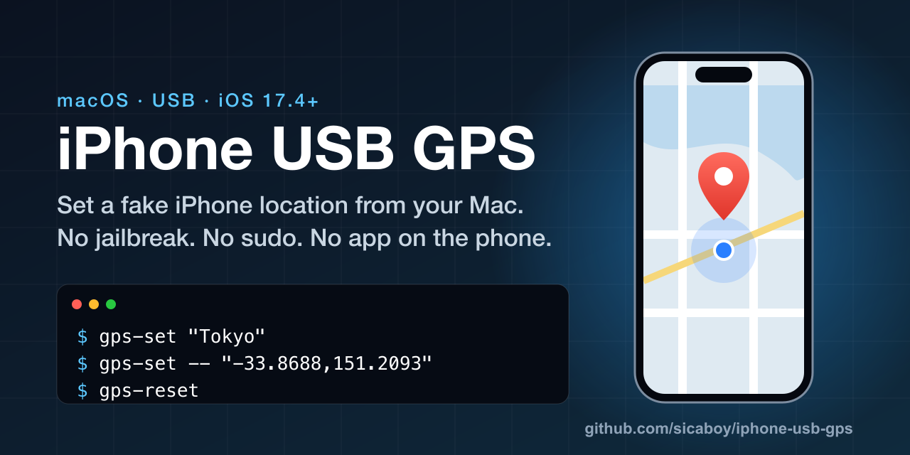

# iPhone USB GPS



[](LICENSE) · [English](README.md)

从 macOS 通过 USB 调用 iPhone 的 DVT LocationSimulation。支持坐标和 Apple Maps 地名搜索。会话按需启动，连续设置复用现有 DVT 连接。iPhone 断开后保留目标记录，供重连同一台设备时清除。

## 安装

需要 macOS 26 或更新版本、Xcode Command Line Tools 和 uv。项目锁定 Python 3.14 和 pymobiledevice3 11.51.0。连接逻辑面向 iOS 17.4+，已在 iOS 27.2 上测试 DVT 请求和设备定位服务日志。

```sh
git clone https://github.com/sicaboy/iphone-usb-gps.git
cd iphone-usb-gps
./install.sh
```

安装会在检出目录创建虚拟环境和 Apple Maps 地名搜索程序，并把命令链接到 `~/.local/bin`。确保该目录在 PATH。使用 `GPS_BIN_DIR=/absolute/path ./install.sh` 可指定其他目录。保留检出目录供已安装的命令使用。

## 使用

把 iPhone 通过 USB 连接到 Mac，解锁后在手机上确认信任。首次使用时，在设置 → 隐私与安全性开启开发者模式，重启、解锁并确认开启。

如果开发者模式开关未显示，只连接目标 iPhone，解锁后从仓库目录运行下列命令，然后重新打开设置页面。

```sh
.venv/bin/pymobiledevice3 amfi reveal-developer-mode
```

```sh
gps-status
gps-set "Melbourne VIC, Australia"
gps-set "东京"
gps-set -- "-33.8688,151.2093"
gps-reset
```

地名查询会发给 Apple Maps。纯坐标输入跳过地名查询。重名地点可加上州、邮编或国家。首次使用 DVT 时，工具可能需要下载开发者镜像，并通过 Apple 签名后安装到设备。连接使用进程内用户态 RSD/RemoteXPC，无需 sudo 或常驻服务。

DVT 回应和会话存活只表示请求及连接状态。请在 iPhone 的 Apple Maps 点定位箭头，通过蓝点确认设置或恢复效果。断线后，保持同一台 iPhone 通过 USB 连接并解锁，再运行 `gps-reset` 清除遗留状态。运行状态和日志保存在 `~/Library/Application Support/iphone-usb-gps/`。

## 常见问题

### 如何在 Mac 上修改或模拟 iPhone 的 GPS 定位？
USB 连接 iPhone 并开启开发者模式，然后运行 `gps-set "东京"` 或 `gps-set -- "-33.8688,151.2093"`。见上文「使用」。

### 需要越狱、sudo 或在 iPhone 上装 App 吗？
不需要。工具通过按需启动的用户态 RSD/RemoteXPC 连接调用 DVT LocationSimulation，无需 sudo 或常驻服务。

### 支持哪些 iOS 和 macOS 版本？
需要 macOS 26 或更新版本、Xcode Command Line Tools 和 uv。连接逻辑面向 iOS 17.4+，已在 iOS 27.2 上测试 DVT 请求。

### 如何恢复真实定位？
运行 `gps-reset`，它会发送 DVT 清除请求并关闭会话。断线后，先重连并解锁同一台 iPhone。

### 找不到开发者模式开关怎么办？
只连接目标 iPhone，解锁后在仓库目录运行 `.venv/bin/pymobiledevice3 amfi reveal-developer-mode`，再重新打开设置。

### 怎么确认定位已生效？
在 iPhone 的 Apple Maps 点定位箭头，看蓝点位置。DVT 回应只表示请求已送达。

## Codex Skill

把 `skills/iphone-usb-gps` 复制到 `~/.codex/skills/`，然后在新对话中说「定位到纽约」「查看 iPhone 定位状态」或「恢复真实定位」。Skill 使用上面的命令。

## 许可证

本项目采用 [GPL-3.0-or-later](LICENSE) 开源许可证。
